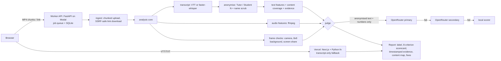

# 8x8 Class Quality Rater

Rates a recorded kids' online class as **Poor / Average / Good / Excellent**. Every reason is tied to a rubric criterion, a timestamped quote and an actionable fix.

**Live:** https://humaniti-class-rater-web.vercel.app (transcript mode: paste, upload or link a VTT/TXT). MP4 upload and link appear once the video worker is deployed; see [Status](#status).

## Architecture



| path | what |
|---|---|
| `worker/rater/` | analysis core (`analysis.py`, `transcript.py`, `asr.py`, `audio.py`, `visual.py`, `content.py`), judge (`judge/`), API (`api/`) |
| `worker/eval/` | LOO eval, ablations, quality metrics, model comparison, content eval, anonymised gold file |
| `worker/modal_app.py`, `worker/Dockerfile` | Modal deploy; Docker fallback for Render or Railway |
| `web/` | Next.js 15 + Tailwind (shadcn-style) UI; `web/api/index.py` is the transcript fallback |
| `SPEC.md`, `docs/specs/` | requirements, assumptions with citations, per-service specs |

## Judge
Fallback chain (`rater/judge/__init__.py`): OpenRouter `RATER_OPENROUTER_MODEL`, then `RATER_OPENROUTER_FALLBACK_MODEL`, then any direct OpenAI/Gemini/Anthropic key or `RATER_LOCAL_LLM_URL` (llama.cpp), then the local scorer. The structured JSON rubric has 8 criteria. A cited timestamp that is not in the payload is dropped. A privacy guard refuses any payload that contains a speaker name.
> OpenRouter is **not** on the organiser's approved list (SPEC Q2). Set `RATER_LLM_PROVIDER=openai|anthropic|gemini|local` to use an approved path.

## Evaluation
See [docs/EVAL.md](docs/EVAL.md) (LOO, ablations, confusion matrices, failure analysis), [docs/EVAL_MODELS.md](docs/EVAL_MODELS.md) (open-source vs frontier) and `worker/eval/results/`. Honest headline: the pre-registered local scorer reaches only **20–30% exact / 60–80% within ±1** on n = 10. That is not above the 40% majority baseline. LLM-judge numbers are pending a working API key.

## Run locally
```bash
cd worker && pip install -r requirements.txt -r requirements-dev.txt && pytest -q
uvicorn rater.api.app:app --port 8000          # worker
cd ../web && npm ci && npm run dev               # UI on :3000 (proxies /api/py to :8000)
```

## Deploy
- Web: `cd web && vercel deploy --prod` (project `humaniti-class-rater-web`).
- Worker: `MODAL_TOKEN_ID=… MODAL_TOKEN_SECRET=… scripts/deploy_worker_modal.sh`. It deploys, sets `NEXT_PUBLIC_WORKER_URL` on Vercel and redeploys the web app.

## Status
- Video worker not deployed: it needs a Modal token, and the organiser has not yet approved the host (SPEC Q1).
- LLM judge: the box OpenRouter key has expired, so the local scorer is used.

## Privacy
Recordings, transcripts and names are never committed (`.gitignore`). Media is processed on the worker and deleted after each job. Only anonymised text and derived numbers go to an LLM.
