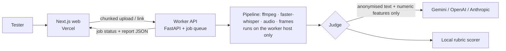

# SPEC: 8x8 Class Quality Rater (v2 rebuild)

This document is the source of truth for the rebuild. Each service has a detailed spec under `docs/specs/`. The v1 prototype is archived in git history and none of its code is reused. What carries over is the dataset, the rubric findings and the lessons learned (see §6).

## 1. Requirements (verbatim from the brief)
| ID | Requirement | Brief line |
|---|---|---|
| R1 | Accept a new class recording as input | "Accepts a new class recording as input (upload or link)." |
| R2 | Output one of four labels | "Classifies its quality as Poor, Average, Good, or Excellent." |
| R3 | Specific, evidence-based explanation | "Explains its assessment with specific, useful observations rather than generic statements." |
| R4 | Genuinely process unseen input | "We will test your application with a recording you have not seen before… it should genuinely process the input and produce a reasoned result." |
| R5 | Hosted, testable app | "Working application: A hosted link where we can provide a recording and see the assessment." / "Make sure your submitted application and links are accessible for testing." |
| R6 | Repo with README, no secrets | "Source code: A GitHub repository with a short README explaining how to run it. Do not include secrets or credentials." |
| R7 | AI interaction history, redacted | "AI interaction history: Relevant prompts and conversations… redact personal information, credentials, and unrelated material." |
| R8 | ≤300-word explanation | "Brief explanation (maximum 300 words): Your chosen approach and why; what worked or failed; the main limitations." |
| R9 | Confidentiality | "Keep recordings confidential. Do not publish, redistribute, or expose them through public applications or repositories. Process recordings only using services specifically permitted by the organiser, especially if children are identifiable." |
| R10 | Deadline | "Submission deadline: Friday, 12:00 PM" (Fri 23 Oct 2026, 12:00 IST) |

## 2. Services
| Service | Path | Spec | Responsibility |
|---|---|---|---|
| Analysis core | `worker/rater/` | [analysis.md](docs/specs/analysis.md) | Transcript parsing, anonymisation, text, audio and visual features, rubric evidence |
| Judge | `worker/rater/judge/` | [judge.md](docs/specs/judge.md) | Structured-JSON rubric judgement. Gemini, OpenAI or Anthropic, plus a local scorer |
| Worker API | `worker/rater/api/` | [worker-api.md](docs/specs/worker-api.md) | FastAPI service: chunked upload, link ingest, job queue, results |
| Web | `web/` | [web.md](docs/specs/web.md) | Next.js UI: upload or link, job progress, result report |
| Eval | `worker/eval/` | [eval.md](docs/specs/eval.md) | LOO evaluation, ablations, failure analysis → `docs/EVAL.md` |

## 3. Assumptions (each one cites the brief or the organiser's email that permits it)
| # | Assumption / choice | Permitted by |
|---|---|---|
| A1 | Stack: Python worker (FastAPI, ffmpeg, faster-whisper, OpenCV), Next.js frontend, Modal or Docker hosting | Brief: "Choose any appropriate AI tools, models, APIs, frameworks, or coding assistants, subject to the data-handling rules below." |
| A2 | A Next.js web UI instead of Streamlit or Gradio | Brief: "A simple Streamlit, Gradio, or similar prototype is fine." and "A simple interface is enough." |
| A3 | No model training on video. Hand-specified rubric features plus an LLM judge | Brief: "You do not need to train your own model or build a production-grade platform." |
| A4 | The approved LLM paths are the Gemini, OpenAI and Anthropic cloud APIs, or fully local. OpenRouter is implemented by owner decision but not approved; see Q2 | Organiser email (Anupam): "Approved LLM services are the OpenAI, Gemini and Anthropic cloud APIs, and fully local is also fine. OpenRouter is NOT on the approved list." |
| A5 | Only anonymised transcript text and derived numeric features are sent to the LLM. Video, audio and frames never are | Brief R9: "Process recordings only using services specifically permitted by the organiser, especially if children are identifiable." |
| A6 | Dataset folders map to labels: excellent→Excellent, good→Good, average→Average, **weak→Poor, quality issue→Poor** | Organiser email (Anupam): "Mapping weak and quality issue to Poor is OK, but explain the choice briefly in EXPLANATION.md." |
| A7 | The design handles recordings up to about 90 minutes (the dataset ranges from 38 to 89 minutes) | Organiser email (Anupam): "Testers will use upload or link with recordings about as long as the dataset samples." |
| A8 | The rubric criteria come from the organiser's `feedbacks.pdf` and nothing else | Brief: "These are for you to explore. We are not prescribing what to examine or how to build the solution." |
| A9 | A Zoom VTT transcript can optionally be supplied with the recording (it skips ASR and adds speaker labels) | Brief: "Choose any appropriate AI tools…". Accepting the recording stays mandatory (R1), and a VTT is never required |
| A10 | Recordings, transcripts, frames and names are never committed. The repo is public | Brief R9: "Do not publish, redistribute, or expose them through public applications or repositories." |

**Out of scope, because the brief does not ask for them:** user accounts and auth, persistent history of past assessments, batch processing, languages beyond what the models handle by default, and any label other than the four.

## 4. Open questions
- **Q2: OpenRouter vs the approved list. Unresolved, flagged.** The owner (Priyansh) has no Gemini key and directed that OpenRouter (`OPENROUTER_API_KEY`) be the single gateway for all models, with the primary model, then a secondary model, then the local scorer. The organiser's email says OpenRouter is NOT approved (A4, R9). Routing OpenAI, Gemini or Anthropic models *through* OpenRouter still sends the anonymised payload to OpenRouter. Implementation: OpenRouter is supported and auto-detected first, with `provider.data_collection = "deny"`. Direct OpenAI, Gemini and Anthropic keys and a fully local model (llama.cpp) remain available. `RATER_LLM_PROVIDER` forces one path, for example `openai` or `local`. **Before submission, either the organiser approves OpenRouter or the deployed config uses a direct approved key or the local model.**
- **Q1: hosting the worker.** Any hosted worker (Modal, Render, Railway) processes uploaded recordings on that provider's infrastructure. The organiser has approved *LLM services* (A4) but not a compute or storage host. Under R9 ("Process recordings only using services specifically permitted by the organiser") **we need the organiser to confirm the host before deploying**. Until then the worker runs locally or self-hosted, and the hosted web UI shows the worker as offline.

| A11 | Domain content coverage (subject, topics, introduced/explained/practised/recapped, minutes, depth) is an extra, explicitly exploratory criterion. It is kept out of the pre-registered label model | Brief: "These are for you to explore"; owner request. Only 3 content remarks exist in feedbacks.pdf, so it is evaluated mainly for VTT/Whisper consistency |

## 5. Acceptance criteria
- AC1: An MP4 upload (up to about 90 minutes, 2 GB) or a link produces a label and a report. The job survives the client polling and does not depend on a single long HTTP request.
- AC2: The report shows the label, a per-criterion scorecard (1–5 with a rationale), timestamped evidence quotes (anonymised) and actionable improvements.
- AC3: The judge payload contains no names and no media. A test asserts this.
- AC4: The LOO eval is reported honestly, with no tuning on test folds. Ablations: transcript-only, +audio, +frames, LLM vs local. Failure analysis is per class.
- AC5: CI runs lint and tests on every PR. Tests need no API keys and no recordings.

## 6. Lessons carried over from v1
- Interaction density (student turns per minute, few long silences) was the strongest separator of the two Excellent classes.
- Generic Haar face detection on Zoom gallery or screen-share layouts was unreliable. v2 classifies the frame layout first (speaker video / camera-off tile / screen share) and aligns camera-off tiles with the moments the tutor is speaking.
- The "unmute"/"mute" keywords are noise for AV complaints, because they are common in interactive classes.
- Whisper output has no speaker labels. v2 needs a tutor/student proxy for ASR transcripts.
- v1 tuned its weights after seeing all 10 classes. v2 fixes its feature set and model *before* running the eval, and fits only inside training folds.
